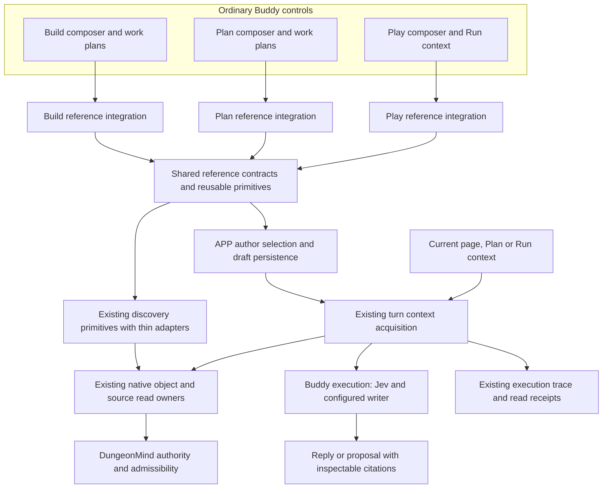
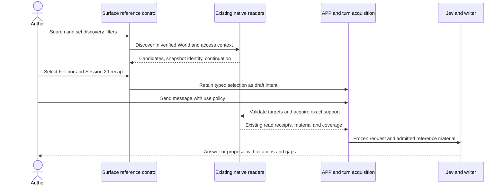

# Reference capability integration in Plan Play and Build

**Status: PROPOSED DESIGN — for discussion; no runtime implementation or rollout authority.**

Integrate reference capabilities into the distinct Plan, Play and Build workflows. An author can select a Graph object, a retained source such as a session recap, or an exact passage using interactions appropriate to the current task. Shared identity, discovery, acquisition and evidence contracts reuse existing native owners; screen layout, control placement and interaction flow require a fit assessment for each surface. Existing prototype behavior is adoption evidence, not a prescribed sibling design. This creates neither a second Graph nor another provenance store.

## Problem and intended experience

The existing composer attachment is Build-only. It searches an older Graph projection, while the Graph browser reads the native catalogue. The live Elderwyld investigation found 1,356 native objects, including Fellinor, but zero objects in the picker's separate projection head. The current attachment schema identifies objects only; it cannot name a recap source or a passage.

The proposed common interaction semantics, with presentation decided per surface:

1. Open references from an appropriate surface control: a composer, editor selection, source reader or Run context action. **@ Reference** and typed `@` are candidate composer affordances, not mandatory placement on every surface. Any floating picker is keyboard-accessible and escapes clipping containers.
2. Search **All**, **Objects**, or **Sources**. A **Recaps** source-type filter makes session material easy to find. Search and filtering invoke native readers, never a model.
3. Inspect a result without selecting it, or select it to add a removable chip. Source inspection also allows selecting an exact passage. Ordinary typing of a name alone does not create a reference.
4. Show the selected context and its use policy before Send. Selection, reading and using a passage as answer evidence remain distinct states.
5. Send through the normal Buddy controls. Build edits its page, Plan prepares its document, and Play retains its Run and current scene. References supplement those contexts without changing their authority or publishing facts.

The Graph browser's **Use as context** action, a source reader's **Reference this source**, and a passage's **Reference selection** should feed the same selection contract. Their surface presentations may differ while sharing verified selection semantics and the existing acquisition path.

## Surface integration and design fit

| Surface | Primary task and context | Integration to validate |
| --- | --- | --- |
| Build | Develop a page while preserving its saved source and working draft. | References beside writing, selections or work-plan steps; clear distinction between inspection, context inclusion and changing the page. |
| Plan | Prepare scenes and encounters using a Plan and source material. | Reference access within preparation and the Plan composer; root/step/scene context is explicit, and selection does not change the editing target. |
| Play | Consult information and act within the current Run and scene. | Fast inspection and reference actions with minimal interruption; returning preserves scene position, notes and adopted mechanics. Do not require an editor-oriented workflow during play. |

Before adopting a prototype component, trace its actual callers, identity assumptions, supported actions and interaction/state model. Choose adoption, adaptation or demolition based on the surface's task. Shared primitives such as search input, result rows, filters, chips and source preview can be reused where they fit. Their technical interfaces do not establish that the surrounding surface designs should be identical.

An intentional surface-specific affordance is acceptable when it has a named owner and exercises the common target/authority contracts. Duplicated query engines, evidence rules, persistence authorities or legacy fallback executors still fail the adoption/demolition gate. Operator dogfood must assess each surface independently; a successful Build demonstration does not establish Plan or Play design fit.

## Existing work to adopt before adding infrastructure

This proposal is principally consolidation and missing integration, not a new search engine. The inventory below is grounded in current Buddy/Core code; an implementation must verify the selected callers and contracts again at its pinned base.

| Existing implementation | Adoptable work | Boundary or required change |
| --- | --- | --- |
| `GraphReferenceSearch`, `searchGraphReferences`, `BuildReferenceSearchProjection`, `PlanWorldGraphObjectsPanel` | A search component is already shared by the composer and Build/Plan tools; retain useful selection/view/accessibility behavior. | Its item adapters depend on the old projection and its display hides results after 40. Replace that dependency; do not introduce a third general reference search control alongside it. Verify which panels still have production callers. |
| `GraphObjectAuthoringObjectRefPicker` and `graphObjectAuthoringSearch` | Existing grouped picker, fuzzy label/alias ranking, Escape/Enter handling and outside dismissal and show-more behavior; used by authoring relationship forms. | Candidate/proposal/manual references are authoring intent, not admitted object identities. Assess the reusable presentation/search primitives for each surface; do not copy the whole authoring protocol into evidence selection. Keep any distinct authoring workflow with its named callers. |
| Core `application/vnext/search.py::SearchReadService` | Indexed deterministic native object search, native candidate admission, exact read identity, match witnesses and result digest. Buddy native queries already call it. | Reuse this owner. Current search returns bounded hits with a limit and no cursor/total-count field. Its token/exact-ID candidate lookup is not automatically a prefix/fuzzy typeahead contract. Its completeness is not proof that every matching object was returned. Any continuation/filter gap belongs in the owning contract, not a competing Buddy search index. |
| `NativeGraphInspection` and `services/native_graph_inspection.py` | Verified native catalogue, admitted name variants, object inspection and source opening. | Reuse identity and read semantics; do not load every assertion or every object for each keystroke. The Graph browser can adopt the shared discovery presentation while retaining its inspection behavior. |
| `NativeBodyNavigation`, `native_corpus_source.py`, `native_corpus.py` and `native_source_catalog.py` | Existing source ownership, coherent source context, source/section identities, full-document and passage reads, durable navigation/read records. These already support agent source navigation. | Reuse the native readers and identifiers beneath the model-tool wrapper. Do not manufacture a provider/model grant for human selection. `capture_native_sources` opens bodies after authorized search; do not call it across the corpus merely to populate a typeahead list. Metadata-first human discovery remains a qualified integration gap. |
| Existing Graph-reference and source-citation renderers/contracts | Stable identity presentation, source opening and actual read/citation records. | An author selection is input intent; a citation is output backed by a read. Reuse their identity/read primitives without accepting a pasted citation or discovery hit as a new read grant or another evidence ledger. |
| Older `build_source_discovery`, classic corpus-navigation branches and archived static preview models | Useful interaction lessons and explicit separation of discovery pointers from claim support. | These use older projection/source DTOs or fixture-only data. They are not the native search authority to restore. Audit current dispatch before retiring live branches; do not promote archived preview data into published truth. |

Historical branch names are not a reason to re-implement their work: `bld/ref01-native-world-graph-search-inspect` and `agent/pr011a3-graph-reference-ui` already correspond to search/inspection and chip-runtime families present in current code. Compare any proposed adoption against current main rather than blindly merging old branches. The `authored-reference-scope-design` proposal concerns controller-inferred current-page versus related-page scope; it is not the author's object/source selection or an enforceable **Only selected sources** policy.

Human discovery and Jev's retrieval may share native query/read primitives. Their authorization origins and execution policies remain explicit. Proposed candidate graphs, published Graph objects and retained original sources also remain distinct domains even when they share a visual search control.

Work that can adopt the resulting shared layer includes the native Graph browser, Build/Plan object panels, all three composers, and work-plan context inputs. Candidate authoring can adopt its search interaction and row presentation without treating unpublished candidates as admitted evidence. Agent retrieval can adopt improvements to native filtering/continuation; it must not inherit UI display limits or substitute fuzzy label matching for source support.

Before implementing a new discovery endpoint, DTO or helper, record which existing primitive it reuses, the concrete contract gap, and whether extension is needed at that owner. A thin presentation adapter may normalize existing results; it must not become another search engine, store, authority or parallel live protocol. Surface-specific controls may remain where their task and owner are explicit; they reuse the canonical discovery/read contracts rather than establishing another authority.

## Architecture



Surface integrations, reusable picker primitives and discovery adapters are product interfaces, not authorities. DungeonMind continues to own source admissibility, evidence/revision binding, scope and visibility. Existing source/body owners supply authorized bytes. APP owns the author's selection, work-plan review and frozen request intent. The existing execution trace records what was actually acquired.

WorldKeeper is absent from this read flow because referencing material does not publish or modify the Graph. Publication remains a separate reviewed action.

The discovery adapter composes existing native object search/catalogue and source catalogue readers into one UI result shape. It does not introduce a new index, a filesystem scan, an independent permission decision, or a conversion into the retired union projection. The Graph browser and picker must resolve the same native identity and revision for the same scope.

## Reference targets and contracts

Use a closed discriminated union. The following names describe responsibilities, not approved wire class names; implementation must pin and reuse the existing native identity/locator contracts.

| Target | Durable identity | Read behavior |
| --- | --- | --- |
| Object | Native entity ID, verified active Graph binding and selection Graph revision | Verify the selected origin, then read the object in the turn's frozen effective Graph revision. |
| Source | Verified source-owner identity, native source artifact ID and exact source revision | Read/search only that selected version. A recap is a source, not an invented Session Graph object. |
| Passage | Verified source-owner identity and exact source revision plus an existing native span/locator and content witness | Open that exact passage; never locate it again by matching its displayed quote. |

Initial target kinds are objects, sources and passages within the current World. Future page, Plan, Run, image or rule targets require an explicit typed contract and their existing owner's resolver; do not smuggle them through an arbitrary JSON payload or file-path fallback.

Source and passage references do not require an active Graph binding or Graph head. Resolve their existing source-owner identity and admitted source revision/span through the source read owner, which may use its own source-knowledge revision. A provisioning Graph can therefore make object discovery unavailable while source discovery and reads remain usable. Source ownership grants no Graph read or publication authority.

A source may be referenced before its extracted candidates are published, if the source itself is admitted and readable under the existing native contract. Retained-but-unadmitted material may be shown as unavailable with a route to the existing source workflow; selecting it must not silently admit it, ingest it, or publish facts.

Illustrative selection shape:

```text
ReferenceSelection
  verified managed World owner
  targets[]
    object   { active Graph binding, native entity ID, selection Graph revision }
    source   { verified source owner, existing native source revision reference }
    passage  { verified source owner, native source revision reference, exact span }
  use policy: include | selected sources only
```

Labels, titles, session numbers, quotes and thumbnails are display metadata. They cannot authorize a read, resolve an ambiguous identity, or substitute for source support. Filenames and directory layout never select authority. Source bodies remain untrusted context data: referencing a recap does not grant its text permission to issue tool calls, change scope, or publish facts. Existing user intent and broker authorization continue to govern execution.

On Send, existing server context acquisition validates the selection and freezes the effective read context. Its manifest refers to the existing native authority/read receipts; it does not copy sources into a second evidence ledger. Surface identity and primary work stay explicit in the ordinary turn envelope. Remove the Build-only reference field and validation restriction when the shared contract is delivered; do not maintain parallel live Build and general reference executors.

### Revisions, drafts and retries

- Object selection follows the chosen identity at Send by default. Retain the selection revision as provenance; freeze one effective Graph revision for the turn. The UI says **Current when sent**. This is not a request for the object's historical state.
- Sources and passages remain pinned to the selected source version. If a newer source exists, show **Newer version available**; replacement is an explicit user action.
- A deleted object, changed World binding, ambiguous merge or unavailable source retains its chip with an explanation. Do not silently substitute a similarly named object or expand scope.
- Deduplicate by authoritative target and effective read policy, not label. Two versions of one source are distinct references and may be selected for comparison. Preserve conflicting selections for resolution instead of discarding one.
- Draft selections are scoped to World, conversation and primary work. Surface changes do not silently attach another document's draft. The same selection feature is available everywhere; automatic cross-surface copying is not implied. Previously sent references remain visible with their historical messages.
- Work-plan root references apply to selected steps; a step may add references. Freeze the effective root-plus-step selection with the reviewed dispatch. Deferred or unselected steps add no context to another step.
- Retry preserves the frozen original request and recovers its receipt after an uncertain outcome. Revalidate current access through the existing owner. Do not silently upgrade a source or Graph pin; starting a fresh request is a separate explicit action.

## Discovery filters and evidence scope

These are separate controls with separate contracts.

**Discovery filters** change which results the user sees:

- Target type: objects or sources; source subtype: recaps, worldbuilding, other admitted source types.
- Campaign and session or session range, where the native metadata supports them. Unknown metadata stays visible as unknown rather than being guessed from paths.
- Object kind, using native classifications rather than text matching against a summary.
- Search text, matching names/aliases for objects and titles/session metadata for sources. Source-content search is offered only when an existing native reader supports it.

Filtering to C1 or Session 29 does not restrict a subsequent answer. Chips carry their exact targets; the turn use policy controls evidence acquisition.

**Use policies** describe how Buddy may use material:

| Policy | Guarantee |
| --- | --- |
| Include these references | Acquire the explicitly requested material through host-owned reads; ordinary authorized retrieval may add other relevant evidence. Jev does not veto an explicit author selection merely because it was not a search hit. |
| Use only selected sources | Factual answer support and additional retrieval must remain within the selected source revisions/passages. A nonempty source set is required; selecting an object alone does not define a source restriction. |

For restricted mode, object references may identify the subject, but only assertions whose required support is admitted within the allowed sources may support the answer. Existing Core evidence/admissibility rules decide support; Buddy must not trim away required external evidence and call an assertion grounded.

The restriction must reach every graph expansion, source opening, retrieval continuation and writer input through the existing execution context. Filtering citations after generation is insufficient. If the owner cannot enforce this scope, do not offer the mode or dispatch a request claiming it is restricted. Never fall back silently to World-wide evidence.

System instructions, permissions, editing targets and operational Run/mechanics state remain necessary control context. Their presence does not make them eligible factual evidence under a source restriction. A primary document must be explicitly included if its content is to support restricted factual claims.

**Only selected sources** limits the evidence universe; it does not promise exhaustive reading of every selected source. A whole-recap summary does require complete relevant source coverage. Report actual passages/pages read and any gaps; never label a partial read as a complete recap review.

## Discovery and execution sequence



Inspecting a source can read it for the user before Send. Those preview bytes do not become execution evidence automatically; the turn still needs its own authorized acquisition or an owner-approved exact receipt reuse.

## UI states and performance

The picker distinguishes loading, no results for these filters, no admitted material, partial results, stale selection, permission failure and transport error. Availability is per target kind: an object-Graph failure must not discard available source results or require a fake Graph initialization. **No matching results** is not evidence that a World has no objects. A missing/retired projection must never become an apparently valid empty native catalogue.

Use native, revision-bound pagination or search continuation. Results carry completeness and continuation information; show more results rather than hiding everything after a fixed first 40. Invalidate a continuation when its scope, filters or native snapshot changes. Cancel stale searches and refuse late responses after a World switch.

Do not load the entire Graph, every assertion or recap body just to show the picker. Return identity, display metadata, supported filters and availability first; acquire detail on inspection or Send. Reuse the existing authenticated request transport and cache ownership, keyed by access generation, verified World, native revision/source epoch, filters and cursor. Authorization failures invalidate access; cached results cannot grant authority.

Opening, searching and selecting invoke no model and cause no source admission, ingestion, publication or authoring save. Send runs the normal request. Large references use the existing model/context capacity checks and source pagination; preserve the request and disclose incomplete acquisition instead of silently truncating or imposing an unexplained per-reference cap.

The floating picker must fit above the composer, escape nested scrolling/error panels, support keyboard selection and dismissal, and announce loading/results/errors accessibly. Pointer position must not determine which World or work item owns a selection.

## User stories and acceptance

| Story | Expected behavior and acceptance |
| --- | --- |
| While editing Edge, I reference Fellinor. | Search returns the same native identity visible in the Graph browser. Selecting it adds a chip; Send acquires its admitted material even if question search finds no name match. |
| I attach Session 29 while staying on Edge. | Filter to recaps, campaign and session; choose the exact source version without navigating away or manufacturing a Graph entity. The answer cites the opened recap material. |
| I ask about a particular paragraph. | Preview the source and select a passage. The reference retains an exact native span and version; later text edits cannot relocate it by quote matching. |
| I use references while preparing a Plan. | Reference controls and the same evidence-policy semantics fit the preparation workflow and Plan composer. The current Plan remains the editing target, and object/source authority is unchanged. |
| During Play, I ask about Fellinor using a recap. | Reference access fits the live Play workflow without leaving the Run or requiring a Build-style editor interaction. Scene position, adopted mechanics, notes and other operational state remain intact; references publish no played facts. |
| I filter results to C1 Session 8. | Only discovery results change. The UI does not imply an evidence restriction unless I also select the restricted use policy. |
| I say use only Session 29. | All factual support stays inside its selected source version; unsupported answers abstain or explain the missing evidence. No hidden World-wide fallback or unselected page evidence. |
| Two objects have the same name. | Kind, scope and source information distinguish them; selection carries the exact native ID, never the first name match. |
| I need a result beyond the first page. | Pagination/search continuation exposes it with honest completeness; no hidden 40-result ceiling. |
| A source or object changes before Send. | The UI and server apply the declared revision policy. Unavailable or ambiguous targets remain recoverable and never silently rebind. |
| A request is interrupted and I retry. | The same frozen references/use policy and idempotent outcome are recovered; a newer draft is not overwritten and a completed request is not executed twice. |
| I put a recap on a work plan and Fellinor on one step. | Selected step dispatch includes the root recap plus that step's object. Deferred steps contribute no references, and edits require the ordinary review revision. |
| I request a summary of the whole recap. | Completion requires the necessary source coverage. Partial acquisition is explicit and cannot masquerade as a complete summary. |

## Small delivery slices

Implementation is not authorized by this proposal. If adopted, re-anchor each owning repository and pin a bounded handoff before its slice. Deliver serially unless a specific independent lease is declared.

| Slice | Independently useful outcome | Owning verification |
| --- | --- | --- |
| 1. Repair native object discovery | Build references find and acquire the same objects as the native Graph browser. Retire the picker's old projection dependency. | Actual native catalogue to picker to selected request to source-backed answer; reproduce Fellinor and a legitimate empty World. |
| 2. Integrate object references into Plan and Play | Shared selection/acquisition contracts with task-appropriate surface controls, including work-plan roots/steps and retained drafts. Reuse primitives after fit assessment. | Independent Plan/Play interaction dogfood and ordinary sends; foreign-World, delayed-response, replay, dispatch and Run-state conservation checks. |
| 3. Add source and passage targets | Attach retained recaps and exact passages through existing native source readers, with discovery filters and continuation. | Source version/span binding, unadmitted/foreign sources, changed content, real recap answer/citation and coverage checks. |
| 4. Enforce selected-source restriction | Expose the restricted use policy only after every evidence path enforces it. Include mode remains independently useful. | Out-of-scope discovery/open/continuation/writer attempts fail closed; unsupported questions do not fall back; primary-work/control context remains correctly separated. |

Keep tests, necessary reader/schema changes, durable contracts and the associated adoption/demolition together with the slice they establish. Do not ship unused source/passage branches or an unenforced restriction toggle in an earlier slice. Do not require a single large PR for the entire design.

## Demolition and acceptance boundary

**Adoption or demolition is a completion requirement, not follow-up cleanup.** Before each slice, inventory the reference-related components, contracts, execution branches, caches and persistence readers it touches. Assign each an owner and a disposition; close that disposition in the slice that replaces its behavior.

- **Adopt:** make the useful implementation part of the current shared reference capability, with a named exercised caller and verification at its owning boundary. Renaming or wrapping an old path while retaining competing authority does not count.
- **Demolish:** remove the superseded production path, its exclusive exports/routes/adapters, configuration and dependencies, and tests or documentation that require retired behavior. Check remaining callers before deleting shared code.
- **Historical read only:** retain a decoder only for identified immutable history or retained data that cannot yet be safely converted. It cannot accept new submissions, dispatch work, authorize reads or become a fallback executor. Name its exact data need; speculative backward compatibility is not sufficient.

The initial inventory must cover at least:

| Existing area | Required disposition |
| --- | --- |
| `SurfaceGraphReferenceInput` and `GraphReferenceSearch` | Adopt useful interaction/accessibility primitives into the appropriate surface integration, or replace and delete the superseded components. Retire the old projection-based discovery and hidden result ceiling. |
| Native Graph/source discovery and read services | Adopt the existing owners and their checks. Consolidate product discovery without another catalogue, permission system or provenance store. |
| Build-only composer/request handling | Adopt useful draft, selection and dispatch logic into the shared path; delete the Build-only reference restriction and duplicated per-surface branches as the shared contract delivers. |
| `AuthoredGraphReference` persistence, work-plan context and retry records | Adopt identity, retention and replay guarantees. Convert verified writable selections through the declared cutover; restrict necessary old event readers to history. |
| Mixed native and legacy reference acquisition | Adopt the native acquisition behavior; remove obsolete reference execution/fallback branches and their exclusive machinery after caller verification. |
| Related tests, fixtures and documentation | Retain tests for adopted behavior, replace mocked-only integration claims with owning-boundary coverage, and delete fixtures/tests/docs whose sole purpose is the retired path. |

A shared dependency still serving another live capability may remain only with that caller, owner and purpose identified; reference traffic must no longer use its obsolete path. If its removal crosses ownership, sequence a bounded owner slice rather than silently dropping the retirement from the objective. No unresolved reference-path disposition counts as complete.

Remove the reference picker's obsolete union-projection dependency and Build-specific live executor restriction as their replacements deliver. Use common selection semantics and the existing native acquisition owners, with explicit surface adapters where task behavior differs. Historical selections and audit events remain inspectable; retained drafts are never discarded merely because their shape is older.

Convert an old selection only when its exact native World, identity and revision can be verified. Otherwise retain it as unavailable and let the user choose again. Do not guess from labels, rebuild legacy Graphs, add dual live resolvers, or recreate directory/file authority to preserve apparent compatibility.

Focused identity/recovery tests remain valuable. They must be complemented by owning-boundary tests and ordinary journeys using the actual native catalogue/source services. Do not mock the picker projection into agreement and call the integration proven. Cover long source/result lists, duplicate names, source-only material, stale/foreign bindings, permission changes and failures during retry. Preserve source/Graph separation: a successful source answer does not establish extraction or publication quality.

Completion requires operator dogfood across Build, Plan and Play, correct cited object/recap/passage answers, enforced restriction when offered, retained-state/recovery evidence, and closure of the adoption/demolition inventory. Verify the cumulative production caller/route graph, exclusive dependencies and the actual ordinary journeys: surface integrations must share the current capability contracts and native authority without a retired live fallback. Distinct surface UX must have an explicit task-based justification. Tests, deletion counts and a new picker alone do not establish acceptance.

## Current implementation anchors

Baseline: Buddy `04d9d6793e197f50069b5b77ea89b3db3d26c9af`. These anchors describe the current code, not the proposed contract.

- `src/surface/SurfaceGraphReferenceInput.tsx` and `src/graphReference/GraphReferenceSearch.tsx` under `apps/live-control-ui`: old projection input and local result filtering.
- `apps/live-control-ui/src/graphLens/NativeGraphInspection.tsx`: current native Graph catalogue and source inspection.
- `apps/live-control-ui/src/planSurface/graphReviewWorkbench/GraphObjectAuthoringObjectRefPicker.tsx` and `graphObjectAuthoringSearch.ts`: existing authoring picker and fuzzy ranking.
- `apps/live_control_server/services/corpus_source_navigation.py`, `apps/live_control_server/integrations/dungeonmind/native_corpus_source.py` and `src/application_state/agent_conversation/native_corpus.py`: existing native source navigation and source/section identities.
- DungeonMind `466c5433e103f474b431d2a4a2632877f60ff45d`, `src/dungeonmind/application/vnext/search.py`: existing native indexed search and bounded result contract.
- `apps/live-control-ui/src/planSurface/components/WorldPlanAgentConversation.tsx`: Build-only composer reference scope and dispatch.
- `apps/live_control_server/models/agent_turn.py`: Build-only request restriction.
- `src/application_state/agent_conversation/authored_graph_references.py`: existing author selection, read records and replay contracts.
- `apps/live_control_server/services/native_graph_reads.py` and `build_authored_references.py`: native target validation and host-owned acquisition.

This proposal reuses those useful guarantees while replacing the disconnected discovery and surface integration.
