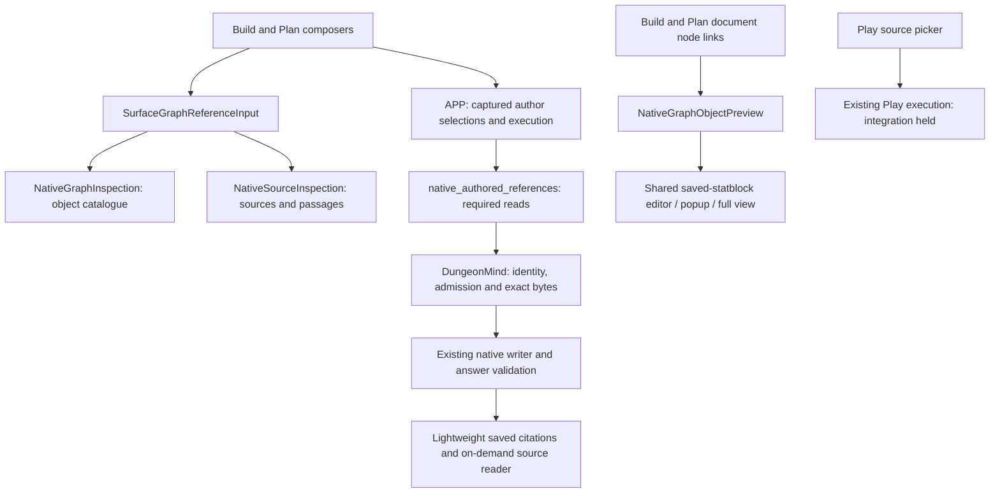

# REFERENCE: adoption and demolition inventory

Status: ACTIVE audit/settlement slice; not full References completion. PRIME owns
one serial documentation PR from `f5ba0f84da66f2121914c9ceb0324061f28987a2`, branch
`codex/reference-adoption-inventory`, existing buddy-context-loop checkout.
Authority: the operator's References/shared-statblock goal. No unmerged parent.
Expected writes: this inventory, HANDOFF-REFERENCE-native-object-picker.md and
HANDOFF-REFERENCE-retire-legacy-plan-picker.md. No product, CI, dependency, runtime,
provider or retained-data writes. Coordination remains off.

## Audited ownership

Paths below are repository-relative. This is a pinned audit of main at the base
above, rather than permission to retire every module with an old name.

Selection, source opening, answer validation and publication have distinct jobs.
Browsing or selecting a reference does not publish a fact, authorize a page edit,
or establish that a model received its contents. The APP producing-input and
citation joins remain necessary. A document node link resolves a current object;
a historical citation opens its captured source revision. Do not substitute one
for the other or resolve an old node by a similar label.

## Adoption / retention / retirement decisions

| Capability or path | Verified caller / owner | Disposition |
| --- | --- | --- |
| Object and source input | `surface/SurfaceGraphReferenceInput.tsx`, mounted by `WorldPlanAgentConversation.tsx`; native inspection components | Adopted for Build/Plan. Play explicitly offers sources only. No second picker needed. |
| Source filters and exact sections | `graphLens/NativeSourceInspection.tsx`; native catalogue/body API and existing section catalogue | Retain. Search/type/campaign/session are navigation filters, not an evidence restriction. Python character offsets and exact revision/hash/section validation remain at their existing owners. |
| Selection identity, draft and pending recovery | `agentInteraction/authoredGraphReferences.ts`, conversation request/pending/retry owners, APP `authored_graph_references.py` | Retain. Same-identity conflicting snapshots fail; invalid raw recovery copies and newer drafts are preserved. Object selection remains unread until execution opens it. |
| Build/Plan native acquisition | `services/native_authored_references.py`, called by native Build/Plan harnesses | Adopted shared owner. DungeonMind supplies admitted bytes; APP retains actual read evidence. Do not copy this executor per surface. |
| Saved reply citations / Details | active history projection and conversation citation readers; #2191 and successors #2266/#2274/#2277/#2278 | Adopted lightweight citation presentation with on-demand bodies/details. Full receipts are not required to show supported markers. Historical Run-memory links remain separate from native corpus-section buttons. |
| Document object links | Build native capability; `planSurface/components/WorldPlanGraphReferenceActivation.tsx`; shared `readCurrentNativeObjectReference.ts` / `NativeGraphObjectPreview.tsx` | Adopted by #2280/#2283. Actual World/editor identity gates late responses. Missing exact old IDs stay unavailable. |
| Shared threat/statblock projection | `statblocks/SavedStatblockSession.tsx`, shared edit host and revision editor, native object preview | Retain one saved identity/version. Popup, conversation and full-view entry points use the shared owner. Generation/portrait proposals do not become established story facts. |
| Old Plan canvas, picker and search | Unmounted `PlanSurfaceCanvas`, `PlanWorldGraphObjectsPanel`, `GraphReferenceSearch`, `searchGraphReferences` | Removed by #2286. Kept the exact mounted `PlanSurfaceCanvasFrame`; removed five tests of retired subjects and their inventory assignments. No alias/re-export remains. |
| Plan diagnostic panels / old resolver adapter | `PlanDogfoodPanel`, `GraphObjectDogfoodPanel`, `usePlanGraphReferenceResolver`, `PlanReferenceProjectionBinding` | Further retirement candidate. Search finds no production mount for the two panels, provider or adapter. Tests still import them. Retire as a separate caller-proven closure; do not confuse the adapter with the live projection card below. |
| Generic reference projection card | `PlanProjectionCatalogRegistration` dynamically loads `PlanReferenceObjectCard` | Retain pending its actual projection-call audit. Its tests and catalogue owner are not made obsolete merely by removing the old route adapter. |
| Manual publication and relationship review | `BuildRunReview` lazily mounts `BuildManualKnowledge`; `ConnectedPageReviewControl` mounts `BuildRelationshipReview` | Retain: exercised authoring/review callers, not duplicate reference search. Source references must not grant their publication authority. |
| Classic Build authored-reference reader | receipt-family branches in `build_jev_harness.py` and `agent_turn_service.py`; writer/image recovery consumers | Not proven removable. Trace fresh non-native admission and retained retry separately before retirement. Do not claim this is historical-only or replace it with a permissive fallback. |
| Old unowned server Plan proposal producer | held #2104 | Held, untouched. Removing the unmounted client canvas does not authorize server retirement or activate this PR. |
| Play native retrieval / selected-source execution | held #2172 at `4b57a7cd66fad17df1106a16f0bc2be3c29ec8c3` | Incomplete, explicitly held. Existing source browsing/retention does not prove successful ordinary native submission or answer delivery. |

UI source paths in the table are under `apps/live-control-ui/src`; service paths
are under `apps/live_control_server`; APP paths are under
`src/application_state/agent_conversation`.

## Scope and evidence limits

The shared input offers Include semantics. There is no Only-selected control in
the audited UI; no new restriction framework is needed to satisfy an offered
control. Source type/campaign/session filters do not restrict subsequent retrieval.
Chronology remains extensible through existing reference variants and source
navigation metadata; no unexercised chronology owner is introduced.

At this checkpoint, #2286 source `a68c1392f91e03d6187ce922663aab00b5fdb1d4`
merged at the audit base. Delivered UI is
`724ed4d58d7daae5e6d314d2ab8a37afd254885e`; API remains
`dc9c6792c4dd1c3c65ad65fb728ab031fcc9cb32`, APP schema `20261108_0141`.
All seven source CI checks, independent source/release/recipe reviews, 180 frozen
route/native owner tests, TypeScript/build and a further 121 focused
citation/history/reference/statblock tests passed. These counts cover their
specific subjects, not all cross-surface requirements.

Controlled read-only verification on that delivered UI proved the existing Plan
text unchanged across reload, conversation launch/history, native object search,
opening the same saved ooze version 2 and portrait in the editable popup, closing
back to the Plan, and opening a saved native Session 29 citation. APP/Core row
multisets and retained session files were unchanged; the runtime lease is released.
The first activation failed with DiskFull and restored the prior UI. Original
failure and independent review of the successful streamed conservation repair are
retained. No provider call, Save, publication, retry or fresh ingestion was used
for this verification.

Private reproducible delivery evidence lives in PRIME's established
`runtime-evidence/q01-published-graph-authority` directory:
`legacy-plan-picker-v3-{resources,browser-verification,ui-final-conservation}.json`,
`legacy-plan-picker-v3-recipe-review.json` and
`reference-final-owner-audit.json`. The evidence location is operational proof,
not runtime configuration or a new provenance authority.

#2283's positive Plan-node activation evidence used an isolated actual-node
fixture with real read-only native/statblock reads. Existing saved legacy Plan
node IDs have no exact native catalogue match, so the browser witness covers
accurate unavailability/focus return, not a positive saved native node. This
limitation is preserved rather than rewriting user content to create a witness.

## Remaining bounded work and completion gate

1. Reconcile remaining surface/recovery evidence against the goal, including
   exact source/passage selection, submit, reload, continuation and retry.
   Existing owner tests and historical proofs must be checked for the exact
   contract they exercise; a picker smoke test alone does not close execution.
2. Retire the unmounted diagnostic/resolver closure only after auditing all
   imports, retained tests and CSS. Its `PlanDogfoodPanel.test.tsx` appears in
   `ci/contracts.json` and the frozen original-command fixture, and its tests
   appear in `ci/test-classification.json`. Active CI #2288 owns overlapping
   qualification/inventory paths. Re-anchor that owner before a separate removal
   slice; do not silently edit its active write lease or frozen historical fixture.
3. Audit the retained classic acquisition and live generic card callers before
   deciding whether they must be adopted or retired. A type/name match alone is
   insufficient deletion evidence.
4. #2172 must be explicitly resumed and re-partitioned against current main before
   native Play execution can close. This inventory neither resumes it nor treats
   its retained scaffold as implemented. #2104 remains a separate hold.

Review this inventory against code callers, exact delivery evidence and current
PR holds. Validate its relative document links and cumulative documentation diff;
obtain independent review and required PR checks before merge. No UI activation
is needed for this documentation-only slice. The complete goal stays active:
this inventory establishes decisions and remaining work, not full completion.
