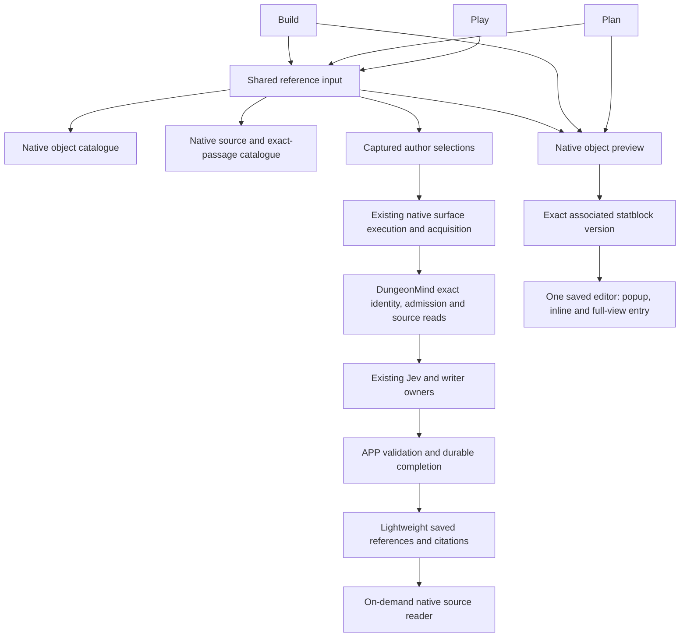

# REFERENCE: adoption and demolition inventory

Source audit baseline: `a2716bdec99f0020aafe2f3b473d6a1d2f4d78f6`.
Status: source settlement; the complete goal remains open. Source support,
source qualification and proof on the running product are distinct below.
This inventory grants no runtime or product-implementation lease.

PRIME owns this serial documentation settlement on
`codex/reference-final-source-settlement` in the existing buddy-context-loop
checkout, based on the audit baseline above. Expected writes are this inventory,
HANDOFF-REFERENCE-unused-selected-card.md and
HANDOFF-REFERENCE-build-reference-admission.md. No unmerged parent.
No product, CI manifest, dependency, provider, database or service changes.
Verify current callers, exact merge records and retained evidence, inspect the
three-file cumulative diff and obtain independent review before source merge.
Existing test runs below are pinned historical evidence, not new qualification
of this documentation commit. The operator recovery hold, #2104 hold and
coordination-off instruction remain.

## Audited ownership

This is source topology, not a claim that all of it is activated on5202.
Selecting a reference neither reads it into a model nor publishes a fact.
APP captures the selection and actual producing input; DungeonMind owns admitted
identity and source bytes. Browsing filters are navigation, not execution scope.
A document object link opens an object; a historical citation opens its captured
source revision. Never substitute a similar label or a fresh read for retained
exact evidence.

## Adoption / retention / retirement decisions

UI paths are under `apps/live-control-ui/src`. Service paths are under
`apps/live_control_server/services`; APP paths under
`src/application_state/agent_conversation`.

| Capability | Current owner / caller | Decision |
| --- | --- | --- |
| Build, Plan and Play selection | `surface/SurfaceGraphReferenceInput.tsx`, mounted by `planSurface/components/WorldPlanAgentConversation.tsx` | Adopted shared object/source picker. The composer no longer passes Play's former `sourceOnly` restriction. Mixed native Play selection is source-complete in #2307, not yet proven on the held runtime. |
| Object and source discovery | `graphLens/NativeGraphInspection.tsx`, `NativeSourceInspection.tsx` and native catalogue APIs | Retain supported search/type/campaign/session and exact-section navigation. No second search protocol. Revision, section and Python-offset checks remain at their existing owners. |
| Selection and recovery | `agentInteraction/authoredGraphReferences.ts`, conversation pending/retry owners and APP `authored_graph_references.py` | Retain exact snapshots and human indexes through submit/history/replay. Conflicts, invalid recovery copies and newer drafts remain protected. |
| Native acquisition | `native_authored_references.py`, native Build/Plan/Play harnesses, shared native execution and APP completion | Adopted across the three governed surfaces. #2172 implemented ordinary native Play execution; #2307 enabled object/mixed admission and capture. Do not duplicate the executor or infer a successful live answer from a picker test. |
| Saved citations and Details | Lightweight history projection, `SavedCitationAnswer.tsx`, `SourceCitationEvidence.tsx` and native source readers | Adopted supported markers without loading full receipts. Exact bodies/details load on demand; inline suggestions, direct review, newer drafts and the single Details owner remain. Run-memory citations remain a distinct supported family. |
| Object links and statblocks | Build capability, `WorldPlanGraphReferenceActivation.tsx`, `NativeGraphObjectPreview.tsx`, `NativeObjectStatblock.tsx`, `SavedStatblockSession.tsx` | Adopted exact target/version and one editor owner. Conversation and popup move the same editor; full view opens the explicit revision. No disconnected statblock copy. |
| Creation and portraits | `NativeThreatCreationPanel.tsx` mounted by `StatblockWorkbenchModule.tsx`; native creation and World mechanics association APIs; `SavedMechanicsRevisionEditor.tsx` / `MediaImageWizard` | Retain existing explicit-tooling path and authority owners. Source, native creation and mechanics association are separate checks. Portrait selection is saved with a new mechanics revision; a generated proposal is not an established story fact. |
| Retired Plan picker/canvas/search | #2286 | Removed unmounted `PlanSurfaceCanvas`, `PlanWorldGraphObjectsPanel`, `GraphReferenceSearch` and `searchGraphReferences`; retained the mounted `PlanSurfaceCanvasFrame`. |
| Retired opening helpers and diagnostic collection | #2310 and #2311 | Removed unused opening hook/policy and `GraphObjectDogfoodPanel` with private model/storage/CSS. Existing browser records were not cleared. |
| Retired Play sheet wrappers | #2312, merge `4cf63addb3925f1f9dec775f8fba843c287de566` | Removed unmounted `PlayGraphObjectSheet` and private `PlayThreatMechanicsSection` plus their exclusive tests. Shared mechanics readers/renderers remain. This does not implement historical Runbook occurrence derivation or Add to Combat. |
| Retired selected-object presentation | #2318, merge `7953f83c434fc5fe4f1cc0b7f71a065a4721576e` | Removed unmounted `SelectedObjectCard` and its private actions/source-preview/roll-format helpers, exclusive tests and private CSS. The fallback model and nine model cases remain because the registered renderer consumes them. This does not retire that renderer or the host capability. |
| Remaining Plan diagnostic/resolver/card | `PlanDogfoodPanel`, `usePlanGraphReferenceResolver`, `PlanReferenceProjectionBinding`, registered `PlanReferenceObjectCard` and activation APIs | Unmounted or unreachable retirement candidate, not proof of a live feature. Audit the whole activation closure. Preserve the shared host's mounted tools and statblock callers. Its frozen-CI-command dependency remains unresolved below. |
| Manual publication/review | `BuildRunReview` → `BuildManualKnowledge`; `ConnectedPageReviewControl` → `BuildRelationshipReview` | Retain exercised publication/review owners. Reference selection does not grant publication authority. |
| Classic authored-reference reader and fresh admission | Receipt-family dispatch in `build_jev_harness.py`, `agent_turn_service.py`, `build_authored_references.py` and `AgentTurnRequest` | #2319 requires the saved Build basis for authored references before dispatch. Existing Build-kind, saved-state, revision and digest checks remain. Such fresh requests therefore select governed/native execution; retained classic receipts still select their exact capture/recovery/writer/image consumers. Preserve those readers. This does not classify every generic Graph request or standalone classic helper as historical-only. |
| Old server Plan proposal producer | #2104 | Explicitly held. Client retirement does not authorize this server change. |

The current UI offers Include semantics. It offers no Only-selected control;
there is no missing restriction framework to invent. The `sourceOnly` component
option is a picker-type filter, not an Only-selected execution restriction.
Chronology remains extensible through existing variants and source navigation;
this audit adds no unused chronology framework.

## Requirement-by-requirement proof and remaining work

The latest retained full frontend diagnostic is exact head
`9b07f7f96c87cc1de2a4a1ac9ea51dcc89355f8a`; its frontend tree equals the audit
baseline's frontend tree. The named retained cases below pass there; the full
diagnostic remains red. This is technical source evidence, not proof on the
current running product. Mock transport and provider-free factory checks are
labeled; neither establishes real-provider output quality.

| Goal requirement | Existing owning evidence | What remains unproved |
| --- | --- | --- |
| Supported citations on initial lightweight history | `WorldPlanAgentConversation.worldHistory.test.tsx`: “shows native citations on initial lightweight history without opening Details” | Delivered-version initial load and reload must be reverified after recovery. |
| Delayed hydration, failures, one Details, drafts and direct review | Same suite: uncited text stays mounted during hydration; exact-detail failure/mismatch; single Details; lightweight page-review and retry cases | Current controlled browser proof, including failure handling; old browser reports alone are insufficient. |
| Objects, recaps, exact passages and supported filters | `SurfaceGraphReferenceInput.test.tsx`12/12; `NativeSourceInspection.test.tsx`23/23; shared native catalogue/body tests | Cross-surface live selection/source-opening journey on the delivered version. |
| Submit, reload, continuation and exact retry | World-history mixed Play submission/pending reload and saved-selection hydration cases; Plan lightweight retry/refusal cases; Build direct retry owners | Ordinary live replay/continuation with preserved unsent work. Do not turn a positive mounted transport test into a paid-provider claim. |
| Native Play actual execution and persisted citations | `tests/test_play_authored_source_references.py::test_shared_play_ordinary_factory_uses_jev_writer_and_replays_saved_run_answer`: provider-free ordinary factory, APP/Core fixtures, work/selected/automatic/memory/Rules/Graph/object/mixed/failure cases. `test_native_play_graph_postgres.py` covers durable admission/reconciliation | Activate the required reader fence only under the resolved recovery plan; prove supported ordinary delivery. The retained pre-deletion Play trace records `plan_writer_completion_rejected` and `play_jev_delivery_failure`; it is not positive answer-delivery proof. |
| Exact native source opening | `SourceCitationEvidence` / native citation protocol and source-owner tests; native readers remain mounted | Current browser source opening, late/read-error behavior and exact revision on delivered code. |
| Tool-created threat and mechanics association | Mounted `NativeThreatCreationPanel.test.tsx`10/10; `tests/test_native_threat_creation.py`, `test_world_mechanics_associations.py` and PostgreSQL owners | Read-only retained checks now verify original acceptance, committed revision, association and Core-admitted creature identity. Complete the live create/associate/reopen proof on recoverable state; do not create another identity to manufacture proof. |
| Popup / surface / conversation / full-view identity | `SavedStatblockSession.test.tsx`27/27, `NativeObjectStatblock.test.tsx`4/4, `NativeGraphObjectPreview.test.tsx`5/5, `StatblockPage.test.tsx`6/6 | Both retained exact versions are readable with matching mechanics digests; the newer revision has its original parent and one asset binding. The controlled cross-entry-point UI journey, caller position and draft preservation remain unproved after recovery. |
| Portrait generation/selection, Save/reload and stale conflicts | Existing revision editor and portrait owner tests; same editor survives inline/popup moves, unknown Save and version refusal | Current end-to-end generation/review/selection/Save proof and source navigation. Existing portrait or mocked selection is not a new generation witness. |
| Complete adoption/demolition inventory | Current caller decisions above; #2286/#2310/#2311/#2312 retirements | Resolve the remaining Plan diagnostic/activation closure's CI-owned dependency. #2318 settles the selected-card leaf; #2319 settles the missing fresh Build-reference basis. Retain exact classic recovery readers. |

## Evidence locations and qualification limits

Retained evidence now lives under the established private
`/home/drakosfire/Projects/.buddy/evidence` root. It is operational proof, never
runtime configuration or another provenance authority:

- `reference-play-sheet-source-merge.json` and
  `reference-play-sheet-93f8f2ac3/{source-audit,discovered-comparison}.json`:
  actual merge tree equals reviewed source; nine CI guards, exact-head local
  frontend/build and immutable-evidence validation pass. Discovered7435/164
  removes exactly ten passing exclusive cases from qualified parent7445/164,
  with no added/newly failing cases or changed shared first-line causes.
  The full diagnostic remains red, not release-qualified.
- `reference-selected-card-source-merge.json` and
  `reference-selected-card-9b07f7f96/{source-audit,discovered-comparison}.json`:
  #2318's exact reviewed source equals its merge tree. Nine CI guards and exact
  local hosted frontend/build pass. Discovered7412/164 removes exactly23 passing
  private cases, keeps the nine fallback-model cases and introduces no new failure
  or changed shared first-line cause. The registered capability remains intact.
- `reference-build-admission-7b6afef13/{source-merge,owning-comparison}.json`:
  #2319's three owning blobs equal the reviewed head at its actual merge.
  The original four orphan-reference HTTP cases fail before the repair; all eight
  negative/positive cases pass afterward. Query-and-answer1179 passes at exact
  7b6afef13c09a6daab843a8f449546d12d92bf1f. The wider backend diagnostic remains
  82fail/2error on both base and candidate with identical IDs/error lines; candidate
  adds eight passes. These are not a whole-current-main backend qualification.
  The initial hosted sample's ten LocalWorld failures remain retained; exact-base
  and exact-candidate recheck pass/validate with identical frontend/CI trees. The
  nondeterministic UI failures were not repaired by this backend change.
- `runtime-recovery-20261109/ooze-retained-identity-audit-20261109.json` and
  `ooze-native-admission-audit-20261109.json`: the original draft/acceptance files
  still match their protected hashes; existing typed invariants agree with the
  surviving APP association and committed revision operation. Core's existing
  read context and EntityReadService admit the exact creature at the native head.
  Local DungeonMind GETs return original and selected exact statblock revisions
  with valid canonical mechanics digests; the selected version has one asset
  binding and the original parent. APP remains at0143, and neither database was
  modified. This is surviving-state/read proof, not fresh generation, media
  delivery, full UI editing, current Buddy authorization or activation proof.
- `play-object-backend-b413d2e57/{query,reference-owners}.log`: retained exact
  b413d2e57ea1fa7e7eb340dbd9af6596afc21b50 records of1142 query-and-answer and145
  owner tests passing. These are historical backend qualification, not a new
  whole-current-main run or a live provider witness.
- The earlier `runtime-evidence/q01-published-graph-authority` directory was
  deleted during storage cleanup. Historical browser checkpoints recorded in
  Git are useful leads, not independently recoverable complete proof here.
  `runtime-recovery-20261109/partial-recovered-evidence.tar.gz` is partial only.
  Do not claim that it restores the original full evidence or session state.

Original failures and superseded source heads remain retained; no retry or test
omission is used to label an unresolved failure inherited. #2314 fixed the
encounter test's asynchronous observation; #2315 fixed the actual first image-edit
click being erased by passive initialization. They are qualified separate slices.

## Held dependencies and next bounded actions

1. The operator instructed that the original API/UI processes remain running
   while deleted runtime/session/config/evidence recovery is assessed. Both
   PostgreSQL volumes survived; do not restore old dumps over them. No verified
   full `runtime/session22` backup has been established. Do not invent a session,
   regenerate credentials or interpret an automatic continuation as lifting this hold.
2. #2307's no-op reader fence `20261109_0144` is source-merged; this audit does
   not apply it or claim current-schema readiness. Re-anchor actual schema,
   launch configuration, exact source and retained-state conservation before
   any eventual activation. #2172 and #2307 source completion are distinct from
   successful current-runtime proof.
3. The browser bridge's most recent read-only inventory returned no browsers:
   native pipe unavailable. Re-establish it before controlled browser verification;
   do not substitute an unrelated mock UI for delivered-version proof.
4. `PlanDogfoodPanel.test.tsx` and `planDogfoodReport.test.ts` are named by both
   `ci/contracts.json` and the frozen original-command fixture. The current guard
   requires exact historical equality. CI #2288 owns additive qualification/guard
   work; the shared Play handoff permits only atomic retired-test manifest entries.
   Retiring this closure needs an owning contract decision. Keep the frozen
   fixture, unrelated checks and necessary shared tools; do not add dummy tests,
   a retirement allowlist or a compatibility wrapper to preserve dead paths.
5. Keep #2104's explicit hold and ADVERSARY coordination off. Retrieval and
   benchmark experiments are not this audit's implementation work.

The complete goal requires the missing technical journeys and protected delivery.
Source merges, test counts and this inventory do not establish completion.
