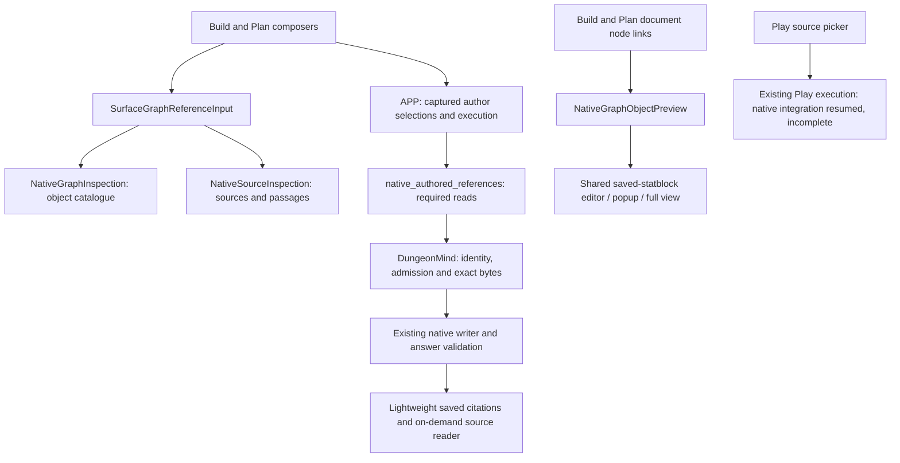

# REFERENCE: adoption and demolition inventory

Status: ACTIVE audit settlement; not full References completion. PRIME owns one
serial documentation slice from `d3182d5e7`, branch
`codex/reference-caller-audit-settlement`, existing buddy-context-loop checkout.
Authority: the operator's References/shared-statblock goal. No unmerged parent.
Expected writes: this inventory only. No product, CI, dependency, runtime,
provider or retained-data writes. Coordination remains off. Validate the changed
caller classifications against production imports and admission conditions,
inspect the cumulative diff, and obtain independent review and required checks.

This slice corrects a distinction in the earlier audit: a registered renderer
is not necessarily reachable from a mounted production activation path. The
older delivery checkpoint below remains historical evidence, not the currently
served runtime revision.

## Audited ownership

Paths below are repository-relative. This is a pinned audit of main at the base
above, rather than permission to retire every module with an old name.

Selection, source opening, answer validation and publication have distinct jobs.
Browsing or selecting a reference does not publish a fact, authorize a page edit,
or establish that a model received its contents. The APP producing-input and
citation joins remain necessary. A document node link resolves a current object;
a historical citation opens its captured source revision. Do not substitute one
for the other or resolve an old node by a similar label.

## Adoption / retention / retirement decisions

| Capability or path | Verified caller / owner | Disposition |
| --- | --- | --- |
| Object and source input | `surface/SurfaceGraphReferenceInput.tsx`, mounted by `WorldPlanAgentConversation.tsx`; native inspection components | Adopted for Build/Plan. Play explicitly offers sources only. No second picker needed. |
| Source filters and exact sections | `graphLens/NativeSourceInspection.tsx`; native catalogue/body API and existing section catalogue | Retain. Search/type/campaign/session are navigation filters, not an evidence restriction. Python character offsets and exact revision/hash/section validation remain at their existing owners. |
| Selection identity, draft and pending recovery | `agentInteraction/authoredGraphReferences.ts`, conversation request/pending/retry owners, APP `authored_graph_references.py` | Retain. Same-identity conflicting snapshots fail; invalid raw recovery copies and newer drafts are preserved. Object selection remains unread until execution opens it. |
| Build/Plan native acquisition | `services/native_authored_references.py`, called by native Build/Plan harnesses | Adopted shared owner. DungeonMind supplies admitted bytes; APP retains actual read evidence. Do not copy this executor per surface. |
| Saved reply citations / Details | active history projection and conversation citation readers; #2191 and successors #2266/#2274/#2277/#2278 | Adopted lightweight citation presentation with on-demand bodies/details. Full receipts are not required to show supported markers. Historical Run-memory links remain separate from native corpus-section buttons. |
| Document object links | Build native capability; `planSurface/components/WorldPlanGraphReferenceActivation.tsx`; shared `readCurrentNativeObjectReference.ts` / `NativeGraphObjectPreview.tsx` | Adopted by #2280/#2283. Actual World/editor identity gates late responses. Missing exact old IDs stay unavailable. |
| Shared threat/statblock projection | `statblocks/SavedStatblockSession.tsx`, shared edit host and revision editor, native object preview | Retain one saved identity/version. Popup, conversation and full-view entry points use the shared owner. Generation/portrait proposals do not become established story facts. |
| Old Plan canvas, picker and search | Unmounted `PlanSurfaceCanvas`, `PlanWorldGraphObjectsPanel`, `GraphReferenceSearch`, `searchGraphReferences` | Removed by #2286. Kept the exact mounted `PlanSurfaceCanvasFrame`; removed five tests of retired subjects and their inventory assignments. No alias/re-export remains. |
| Plan diagnostic panels / old resolver adapter | `PlanDogfoodPanel`, `GraphObjectDogfoodPanel`, `usePlanGraphReferenceResolver`, `PlanReferenceProjectionBinding` | Further retirement candidate. Search finds no production mount for the two panels, provider or adapter. Tests still import them. Retire as a separate caller-proven closure; audit its activation closure together with the registered card below. |
| Generic reference projection card | `PlanProjectionCatalogRegistration` registers `PlanReferenceObjectCard`; `LegacyProjectionHostAdapter` supplies its active resolution | Registered but no mounted production activation found at this checkpoint. `openGraphReference` callers resolve to the unmounted diagnostic panel and resolver binding; the exported `useOpenGraphReference` hook has only its own test caller. Include the card and activation closure in the separately gated retirement audit, rather than calling registration proof of use. Retain the shared host and its live tool renderers. |
| Manual publication and relationship review | `BuildRunReview` lazily mounts `BuildManualKnowledge`; `ConnectedPageReviewControl` mounts `BuildRelationshipReview` | Retain: exercised authoring/review callers, not duplicate reference search. Source references must not grant their publication authority. |
| Classic Build authored-reference reader | receipt-family branches in `build_jev_harness.py` and `agent_turn_service.py`; writer/image recovery consumers | Not proven removable. Trace fresh non-native admission and retained retry separately before retirement. Do not claim this is historical-only or replace it with a permissive fallback. |
| Old unowned server Plan proposal producer | held #2104 | Held, untouched. Removing the unmounted client canvas does not authorize server retirement or activate this PR. |
| Play native retrieval / selected-source execution | Resumed #2172; retained scaffold `4b57a7cd66fad17df1106a16f0bc2be3c29ec8c3` preserved | Operator lifted the PRIME sequencing hold on 2026-11-09. Current-main backend repartition is owned by HANDOFF-PLAY-shared-native-retrieval.md. Incomplete: browsing/retention and old scaffold tests do not prove ordinary native submission or answer delivery. |

UI source paths in the table are under `apps/live-control-ui/src`; service paths
are under `apps/live_control_server`; APP paths are under
`src/application_state/agent_conversation`.

## Scope and evidence limits

The shared input offers Include semantics. There is no Only-selected control in
the audited UI; no new restriction framework is needed to satisfy an offered
control. Source type/campaign/session filters do not restrict subsequent retrieval.
Chronology remains extensible through existing reference variants and source
navigation metadata; no unexercised chronology owner is introduced.

At this checkpoint, #2286 source `a68c1392f91e03d6187ce922663aab00b5fdb1d4`
merged at the audit base. Delivered UI is
`724ed4d58d7daae5e6d314d2ab8a37afd254885e`; API remains
`dc9c6792c4dd1c3c65ad65fb728ab031fcc9cb32`, APP schema `20261108_0141`.
All seven source CI checks, independent source/release/recipe reviews, 180 frozen
route/native owner tests, TypeScript/build and a further 121 focused
citation/history/reference/statblock tests passed. These counts cover their
specific subjects, not all cross-surface requirements.

Controlled read-only verification on that delivered UI proved the existing Plan
text unchanged across reload, conversation launch/history, native object search,
opening the same saved ooze version 2 and portrait in the editable popup, closing
back to the Plan, and opening a saved native Session 29 citation. APP/Core row
multisets and retained session files were unchanged; the runtime lease is released.
The first activation failed with DiskFull and restored the prior UI. Original
failure and independent review of the successful streamed conservation repair are
retained. No provider call, Save, publication, retry or fresh ingestion was used
for this verification.

Private reproducible delivery evidence lives in PRIME's established
`runtime-evidence/q01-published-graph-authority` directory:
`legacy-plan-picker-v3-{resources,browser-verification,ui-final-conservation}.json`,
`legacy-plan-picker-v3-recipe-review.json` and
`reference-final-owner-audit.json`. The evidence location is operational proof,
not runtime configuration or a new provenance authority.

#2283's positive Plan-node activation evidence used an isolated actual-node
fixture with real read-only native/statblock reads. Existing saved legacy Plan
node IDs have no exact native catalogue match, so the browser witness covers
accurate unavailability/focus return, not a positive saved native node. This
limitation is preserved rather than rewriting user content to create a witness.

## Remaining bounded work and completion gate

1. Reconcile remaining surface/recovery evidence against the goal, including
   exact source/passage selection, submit, reload, continuation and retry.
   Existing owner tests and historical proofs must be checked for the exact
   contract they exercise; a picker smoke test alone does not close execution.
2. Retire the unmounted diagnostic/resolver closure only after auditing all
   imports, retained tests and CSS. Its `PlanDogfoodPanel.test.tsx` appears in
   `ci/contracts.json` and the frozen original-command fixture, and its tests
   appear in `ci/test-classification.json`. Active CI #2288 owns overlapping
   qualification/inventory paths. Re-anchor that owner before a separate removal
   slice; do not silently edit its active write lease or frozen historical fixture.
3. Retained classic acquisition remains necessary for historical receipt families.
   Fresh governed Build requests select native source authority: see
   `_governed_build_turn` and `native_surface_sources` in `agent_turn_service.py`.
   Existing classic receipts route through `build_authored_references.py`, including
   frozen object/source recovery and writer/image material. This does not prove
   every non-governed request shape is rejected; audit that admission boundary
   before narrowing or deleting the module. Do not replace retained exact recovery
   with a fresh native read or a label match.
4. The generic card is a retirement candidate, not a live caller established by
   registration alone. Trace `AgentInteractionProvider.openGraphReference` through
   its capability registration and `LegacyProjectionHostAdapter` before deleting
   the closure. The shared projection host also serves mounted statblock, combat,
   Rules and review tools and must not be removed with this card.
5. The operator explicitly resumed #2172 on 2026-11-09. Re-anchor and re-partition
   through its current handoff before implementation; preserve its complete
   acceptance scope. This inventory does not treat its retained scaffold as
   implemented. #2104 remains a separate hold.

Review this inventory against code callers, exact delivery evidence and current
PR holds. Validate its relative document links and cumulative documentation diff;
obtain independent review and required PR checks before merge. No UI activation
is needed for this documentation-only slice. The complete goal stays active:
this inventory establishes decisions and remaining work, not full completion.

## Recovery integration settled after the original checkpoint

#2292 (merge `d39db0c6a2a0493800f82eb77d69e3ef3deb3d4e`) and #2295
(merge `b1e319ede593e05ce7a45e137057af606fe6857b`) expose direct retry on
eligible lightweight Plan and Build history. The existing exact full-turn reader
is invoked on demand. Build dispatch uses the original retained request context
and references; it no longer recaptures the current editor through a separate
retry branch. Newer composer/editor state, receipt validation, duplicate-click
protection and World/surface fences remain required.

#2295's cumulative source review and all seven exact-head CI checks passed.
Its focused mounted transport suite passed 22 cases, and the Plan history suite
passed 301. The wider integration suite still had 75 inherited failures, with no
newly failing names in the retained comparison; it is not a green full suite.
The delivered UI is `3ca77749fbb41a5612d4f7abf54b26dac5dd9f36`; API remained
`16cb2c50bd7ebd4b53de930932b0c070c5a3f3c2`, schema `20261109_0142` during this
verification. The delivery lease is released.

Controlled verification opened an actual saved Session 29 native citation from
Build and displayed direct retry for the active failed request on Plan without
opening reply Details. That request originated on Plan, so the Build view did
not expose a Build retry for it. Positive Build retry dispatch is proven by
mounted mock-transport tests, not a live provider replay. No user retry, Send,
Save, generation or publication was invoked. APP/Core row multisets and retained
session files were unchanged. Evidence:
`build-light-retry-served-browser.json`, `build-light-retry-ui-proof.json` and
`build-light-retry-ui-final-conservation.json` in the private evidence directory
above. These checks settle this recovery slice, not held Play execution or the
complete goal.

## Unused opening-helper source retirement

HANDOFF-REFERENCE-unused-opening-helpers.md removes useOpenGraphReference and
openGraphReferencePolicy, their two unused barrel exports and exclusive tests.
Current symbol/import searches show no production caller. Native object preview,
shared statblock editing, the projection host and threat view-model remain.
Only the two retired test classifications change; no current runtime or stored
browser state is rewritten. The diagnostic/resolver/card closure remains a
separate retirement. Its panel tests are still named by the frozen CI command
fixture, whose equality guard requires an owning contract decision before that
larger removal; it is not silently changed by this slice.

## Private object diagnostic source retirement

HANDOFF-REFERENCE-object-diagnostic-retirement.md removes the unmounted
GraphObjectDogfoodPanel, its private collection model and browser-storage adapter,
three exclusive tests and private graph-object-dogfood CSS. Existing browser
records are preserved. Shared Plan resolution, projection, native reference and
saved-statblock owners remain; this source retirement does not claim their full
integration or remove the separately gated Plan diagnostic/card closure.
