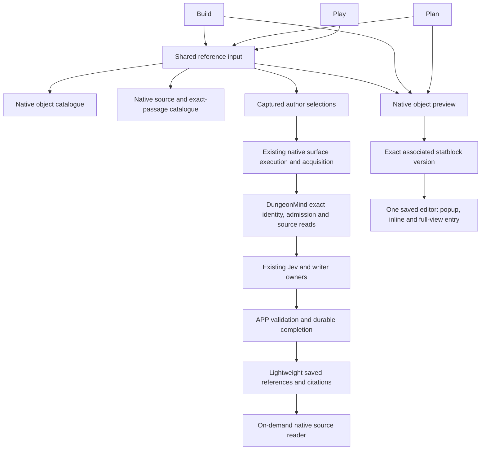

# REFERENCE: adoption and demolition inventory

Source audit baseline: `a2716bdec99f0020aafe2f3b473d6a1d2f4d78f6`.
Evidence reconciliation: 2026-11-10, based on merged source
`113f12de280e0f1d6e814d3e61f44dc3b1153d77`.
Status: adoption/demolition decisions settled; current delivery and remaining
technical verification are separated below. The full thread goal remains open.

PRIME owns this serial documentation-only reconciliation on
`codex/reference-delivery-evidence-settlement` in the existing checkout. Writes:
this inventory and HANDOFF-REFERENCE-native-play-receipt-validation.md. No
unmerged dependency, implementation lease, service change or new provider call.
Verify cited retained artifacts/current source and merged PRs, inspect the two-file
cumulative diff and obtain independent review. The original process hold is
released; #2104 and coordination-off remain. Historical proof is not replaced or
rewritten, and runtime/session22 is not claimed to have been fully recovered.

## Audited ownership

This is the adopted source topology. Delivery proof and remaining operation-level
verification are scoped below; a source diagram alone proves neither.
Selecting a reference neither reads it into a model nor publishes a fact.
APP captures the selection and actual producing input; DungeonMind owns admitted
identity and source bytes. Browsing filters are navigation, not execution scope.
A document object link opens an object; a historical citation opens its captured
source revision. Never substitute a similar label or a fresh read for retained
exact evidence.

## Adoption / retention / retirement decisions

UI paths are under `apps/live-control-ui/src`. Service paths are under
`apps/live_control_server/services`; APP paths under
`src/application_state/agent_conversation`.

| Capability | Current owner / caller | Decision |
| --- | --- | --- |
| Build, Plan and Play selection | `surface/SurfaceGraphReferenceInput.tsx`, mounted by `planSurface/components/WorldPlanAgentConversation.tsx` | Adopted shared object/source picker. The composer no longer passes Play's former `sourceOnly` restriction. Mixed native Play selection is source-complete in #2307; the original runtime hold is released. Current browser proof finds the same native object in Build, Plan and Play; the mixed Play execution/history repair is delivered. Exact selected-passage execution in Plan remains to be closed explicitly. |
| Object and source discovery | `graphLens/NativeGraphInspection.tsx`, `NativeSourceInspection.tsx` and native catalogue APIs | Retain supported search/type/campaign/session and exact-section navigation. No second search protocol. Revision, section and Python-offset checks remain at their existing owners. |
| Selection and recovery | `agentInteraction/authoredGraphReferences.ts`, conversation pending/retry owners and APP `authored_graph_references.py` | Retain exact snapshots and human indexes through submit/history/replay. Conflicts, invalid recovery copies and newer drafts remain protected. |
| Native acquisition | `native_authored_references.py`, native Build/Plan/Play harnesses, shared native execution and APP completion | Adopted across the three governed surfaces. #2172 implemented ordinary native Play execution; #2307 enabled object/mixed admission and capture. Do not duplicate the executor or infer a successful live answer from a picker test. |
| Saved citations and Details | Lightweight history projection, `SavedCitationAnswer.tsx`, `SourceCitationEvidence.tsx` and native source readers | Adopted supported markers without loading full receipts. Exact bodies/details load on demand; inline suggestions, direct review, newer drafts and the single Details owner remain. Run-memory citations remain a distinct supported family. |
| Object links and statblocks | Build capability, `WorldPlanGraphReferenceActivation.tsx`, `NativeGraphObjectPreview.tsx`, `NativeObjectStatblock.tsx`, `SavedStatblockSession.tsx` | Adopted exact target/version and one editor owner. Conversation and popup move the same editor; full view opens the explicit revision. No disconnected statblock copy. |
| Creation and portraits | `NativeThreatCreationPanel.tsx` mounted by `StatblockWorkbenchModule.tsx`; native creation and World mechanics association APIs; `SavedMechanicsRevisionEditor.tsx` / `MediaImageWizard` | Retain existing explicit-tooling path and authority owners. Source, native creation and mechanics association are separate checks. Portrait selection is saved with a new mechanics revision; a generated proposal is not an established story fact. |
| Retired Plan picker/canvas/search | #2286 | Removed unmounted `PlanSurfaceCanvas`, `PlanWorldGraphObjectsPanel`, `GraphReferenceSearch` and `searchGraphReferences`; retained the mounted `PlanSurfaceCanvasFrame`. |
| Retired opening helpers and diagnostic collection | #2310 and #2311 | Removed unused opening hook/policy and `GraphObjectDogfoodPanel` with private model/storage/CSS. Existing browser records were not cleared. |
| Retired Play sheet wrappers | #2312, merge `4cf63addb3925f1f9dec775f8fba843c287de566` | Removed unmounted `PlayGraphObjectSheet` and private `PlayThreatMechanicsSection` plus their exclusive tests. Shared mechanics readers/renderers remain. This does not implement historical Runbook occurrence derivation or Add to Combat. |
| Retired selected-object presentation | #2318, merge `7953f83c434fc5fe4f1cc0b7f71a065a4721576e` | Removed unmounted `SelectedObjectCard` and its private actions/source-preview/roll-format helpers, exclusive tests and private CSS. The model/nine model cases were retained in that slice, then removed with their exclusive renderer in #2344. Shared host capabilities remain. |
| Retired Plan checklist | `PlanDogfoodPanel`, private report/state, exclusive tests and `.plan-dogfood-*` styles | Removed in #2342 after zero production-mount/caller audit. Two live manifest/classification entries retired atomically; the frozen original-command fixture and stored browser notes remain untouched. Delivery qualification is separate. |
| Retired Plan card | `PlanReferenceObjectCard`, exclusive corpus-fallback/model and catalog entry | Removed in #2344: the old opener/binding had no production mount; current Plan object links use native activation/preview. Generic provider/host and shared statblock actions remain. |
| Retired Plan resolver/binding | `usePlanGraphReferenceResolver`, `PlanReferenceProjectionBinding` and exclusive graph/corpus lookup/request helpers | Removed in #2346 after caller closure. Shared revision event moved unchanged to World Graph; load state and derived-view resolution adopt existing shared types. Actions, native activation and generic provider APIs remain. |
| Retired Plan advertisement | Synthetic `graph-reference` descriptor in `surfaceInteractionCompat` and provider Plan-only exception | Removed in this source. Authority requires explicit effective publication plus a live current-lease binding. Generic lifecycle tests adopt explicit native Build declarations; legacy Plan identity alone is tested to fail closed. |
| Manual publication/review | `BuildRunReview` → `BuildManualKnowledge`; `ConnectedPageReviewControl` → `BuildRelationshipReview` | Retain exercised publication/review owners. Reference selection does not grant publication authority. |
| Classic authored-reference reader and fresh admission | Receipt-family dispatch in `build_jev_harness.py`, `agent_turn_service.py`, `build_authored_references.py` and `AgentTurnRequest` | #2319 requires the saved Build basis for authored references before dispatch. Existing Build-kind, saved-state, revision and digest checks remain. Such fresh requests therefore select governed/native execution; retained classic receipts still select their exact capture/recovery/writer/image consumers. Preserve those readers. This does not classify every generic Graph request or standalone classic helper as historical-only. |
| Old server Plan proposal producer | #2104 | Explicitly held. Client retirement does not authorize this server change. |

The current UI offers Include semantics. It offers no Only-selected control;
there is no missing restriction framework to invent. The `sourceOnly` component
option is a picker-type filter, not an Only-selected execution restriction.
Chronology remains extensible through existing variants and source navigation;
this audit adds no unused chronology framework.

## Requirement-by-requirement proof and remaining work

Latest retained full frontend diagnostic: exact source
`69564cbc8679b61bcac0bcd862793d4c4d4235fb`, deployed UI tree
`8cef68c39d35995688f1433ff6ef89526e9e5ad3` (verify against its manifest; test-only
changes distinguish the source from its compiled production preimage).
The diagnostic records7,376 tests:7,216 pass,159 inherited failures, one pending,
plus the same inherited BuildCompose collection failure. Its two new tests pass;
no existing outcome changed versus the retained delivered baseline. Exact hosted
selection and strict build pass. Full discovery remains red, not whole-product
release qualification. Later backend-only media adoption does not alter that UI.

| Goal requirement | Current authoritative proof | Remaining limit / action |
| --- | --- | --- |
| Initial lightweight citations, native source opening and Details | Original mixed Play answer restored through ordinary history, native Session29 citation opened/closed, complete Details/timeline loaded and answer survived reload. `play-native-ui-delivered.json` records the delivered UI witness. | Unit/owner tests cover delayed/error hydration and invalid exact recovery; do not describe each negative case as a new live provider run. |
| Objects, recaps, exact passages and filters | `reference-statblock-browser-resumed-20261110.json`: same retained ooze selected in Build/Plan/Play, C2 session20 filtered to one recap, exact lines12–34 selected, selection survived reload, then probe selection removed. Native source bodies/hash/ranges remain pinned separately. | Catalogue lists59 sources but reports incomplete navigation metadata. Do not infer complete World source coverage from the selector count. |
| Submit, saved history, continuation and recovery | Original mixed Play request delivered an answer before history failed. #2363 adopted native Play history DTO/projector; #2367 removed only the unrelated legacy whole-packet ceiling. Both full-history modes read200; exact answer and two selections survived ordinary continuation/reload, citation inspection and return to the prior conversation. Original failures remain retained. | No inference was replayed to repair the saved read. Existing exact retry/draft-conflict boundaries retain their owning tests; this is not a newly repeated paid retry witness. |
| Plan selected-passage execution | Live Plan object/popup and saved selection behavior plus shared native source/admission/execution owner tests are retained. | Close an ordinary exact selected-passage request and cited delivery in Plan, or locate equivalent retained operation-level proof. A picker or automatic-retrieval answer alone does not prove selected-passage execution. |
| Source adoption/demolition | Decisions above remain settled through #2349; retired callers stay absent. Exact classic recovery readers remain exercised readers, not permission to revive retired producers. | #2104 remains explicitly held. No Only-selected control is offered, so no new restriction framework or unused chronology framework is selected. |
| Shared statblock entry points | Current browser witness renders the same exact saved version in full view and through Build/Plan/Play object previews; popup preserves caller URL, and HP68→69 survives close/reopen before explicit reversion. Exact association/revision digests are retained. #2359 delivers the shared retained Build-proposal projection instead of a generic acknowledgement. | New mechanics Save/reload and positive generated-portrait selection must be established at their actual owners. Existing assets/reader proof are not a fresh generation witness. |
| Portrait failure/recovery | Original real image request is retained. Read-only provider request evidence identified content_policy_violation. GE #34 classifies the explicit SDK-wrapped refusal; Buddy #2371 presents its normalized result. Provider-free real-SDK→GE→HTTP replay and immutable-image checks pass; protected API delivery preserves mechanics and association. | No fresh portrait generation was rerun. The earlier separately requested fal transfer approval remains pending; do not imply it was granted by the unrelated media UI sidequest. |
| Authoring placement/review/layout | Existing authoring fixes remain separate. #2370 adds live ordinary private image placement, autosave/reload, persistent reachable controls and prompt editing; test page was recoverably trashed and the image remains private/staged. | This is image placement proof, not richer agent-directed section editing or a new mechanics revision. |

## Evidence locations and qualification limits

Retained evidence now lives under the established private
`/home/drakosfire/Projects/.buddy/evidence` root. It is operational proof, never
runtime configuration or another provenance authority:

- `reference-play-sheet-source-merge.json` and
  `reference-play-sheet-93f8f2ac3/{source-audit,discovered-comparison}.json`:
  actual merge tree equals reviewed source; nine CI guards, exact-head local
  frontend/build and immutable-evidence validation pass. Discovered7435/164
  removes exactly ten passing exclusive cases from qualified parent7445/164,
  with no added/newly failing cases or changed shared first-line causes.
  The full diagnostic remains red, not release-qualified.
- `reference-selected-card-source-merge.json` and
  `reference-selected-card-9b07f7f96/{source-audit,discovered-comparison}.json`:
  #2318's exact reviewed source equals its merge tree. Nine CI guards and exact
  local hosted frontend/build pass. Discovered7412/164 removes exactly23 passing
  private cases, keeps the nine fallback-model cases and introduces no new failure
  or changed shared first-line cause. The registered capability remains intact.
- `reference-build-admission-7b6afef13/{source-merge,owning-comparison}.json`:
  #2319's three owning blobs equal the reviewed head at its actual merge.
  The original four orphan-reference HTTP cases fail before the repair; all eight
  negative/positive cases pass afterward. Query-and-answer1179 passes at exact
  7b6afef13c09a6daab843a8f449546d12d92bf1f. The wider backend diagnostic remains
  82fail/2error on both base and candidate with identical IDs/error lines; candidate
  adds eight passes. These are not a whole-current-main backend qualification.
  The initial hosted sample's ten LocalWorld failures remain retained; exact-base
  and exact-candidate recheck pass/validate with identical frontend/CI trees. The
  nondeterministic UI failures were not repaired by this backend change.
- `runtime-recovery-20261109/ooze-retained-identity-audit-20261109.json` and
  `ooze-native-admission-audit-20261109.json`: the original draft/acceptance files
  still match their protected hashes; existing typed invariants agree with the
  surviving APP association and committed revision operation. Core's existing
  read context and EntityReadService admit the exact creature at the native head.
  Local DungeonMind GETs return original and selected exact statblock revisions
  with valid canonical mechanics digests; the selected version has one asset
  binding and the original parent. APP remains at0143, and neither database was
  modified. This is surviving-state/read proof, not fresh generation, media
  delivery, full UI editing, current Buddy authorization or activation proof.
- `play-object-backend-b413d2e57/{query,reference-owners}.log`: retained exact
  b413d2e57ea1fa7e7eb340dbd9af6596afc21b50 records of1142 query-and-answer and145
  owner tests passing. These are historical backend qualification, not a new
  whole-current-main run or a live provider witness.
- The earlier `runtime-evidence/q01-published-graph-authority` directory was
  deleted during storage cleanup. Historical browser checkpoints recorded in
  Git are useful leads, not independently recoverable complete proof here.
  `runtime-recovery-20261109/partial-recovered-evidence.tar.gz` is partial only.
  Do not claim that it restores the original full evidence or session state.

Original failures and superseded source heads remain retained; no retry or test
omission is used to label an unresolved failure inherited. #2314 fixed the
encounter test's asynchronous observation; #2315 fixed the actual first image-edit
click being erased by passive initialization. They are qualified separate slices.

## Current delivery evidence and next bounded actions

1. Current API delivery source is
   `c4581b1b0dedaf8f40fb8cabebc3f0314961bd3a` / schema147. It contains only the
   reviewed history and media repairs over the retained API lane; unrelated main
   writer experiments were not activated. It verifies the immutable GE wheel
   from merged `7c929082bfa9b8c5af9815e6429db5230d9caefe` without mutating the
   shared runtime environment. UI source remains
   `69564cbc8679b61bcac0bcd862793d4c4d4235fb`. Both surviving PostgreSQL physical
   identities, original failed/saved turn and exact statblock association/revision
   hashes survived protected delivery. No dump was restored over retained data.
2. Private `play-history-delivered.json`, `play-native-ui-delivered.json`,
   `image-studio-{api,ui}-delivered.json`, `image-studio-browser-proof.json` and
   `media-refusal-api-delivered.json` bind source/dependency/assets and retained
   state. `image-studio-final-discovered-comparison.json` compares exact outcomes.
   Source/caller inventory and real browser witnesses support different claims;
   none is a substitute for the other.
3. The browser bridge is connected and the obsolete bridge blocker is removed.
   `reference-statblock-browser-resumed-20261110.json` remains a partial earlier
   witness; later merged/delivered repair evidence supersedes its specific open
   proposal/history failures, not every item in its `not_proven` list.
4. Close remaining Plan selected-passage execution and operation-level statblock
   Save/image proof. Distinguish outstanding evidence from a confirmed product
   failure. Preserve original failures and do not create another canonical
   identity merely to manufacture proof.
5. Keep #2104 held and ADVERSARY coordination off. Retrieval/benchmark experiments
   and the Index/LocalWorld work owned by another model remain outside this lane.

Source adoption/demolition is settled. Remaining goal work is explicit operation-
level verification and repairs justified by it; this reconciliation does not mark
References or the full thread goal complete merely because source tests pass.
