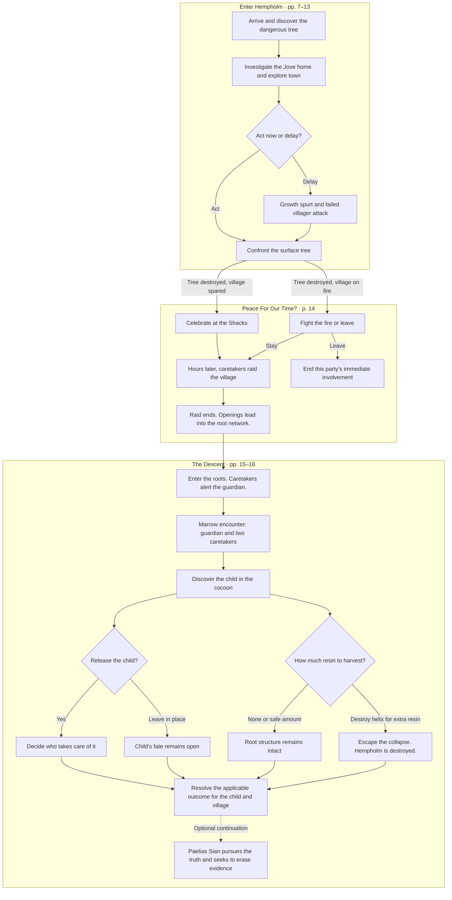

# Of Conks & Cons — source-to-Plan Gold

Development reference constructed from the original 19-page PDF,
SHA-256 `9c6458d5c742945e7b0c0abfcaef217384a8a14a6c503458f2ad49e7ee143e8c`.
Page references use **printed folios**. In the range below, PDF page in
one-based viewer numbering is printed folio minus one. Match the hash
before applying that conversion.

Start fresh with DeepSeek OCR 2 through local Buddy. Keep this rubric out
of model inputs. No historical Plan, Runbook, Graph bundle, or OCR output
is seeded into the rehearsal. The labels below describe GM prep and
possible outcomes.

The two decisions in the Marrow can coexist. Continued inaction or party
departure does not automatically advance the party into the next scene.

## Source-to-Plan checklist

**Core** items cover the main path and consequential branches. **Optional**
items should be callable when relevant. **Reference** items should open from
the relevant beat or location. Keep section headers and linked map or
statblock regions with the associated source block.

| ID | Kind | Printed page and section | Evidence to recover and preserve in the Plan |
| --- | --- | --- | --- |
| C01 | Core beat | 5–7, hooks, summary, Part 1 opening | Party arrives in Hempholm and discovers the tree's immediate danger. Support a cold open or an approach through village roleplay. |
| C02 | Core beat | 10, Area 4 | The tree threatens the Jove home. Mark and Torbin provide local context about the seed and its origin. |
| C03 | Core choice | 11, Area 5 | Inspect and choose how to confront the tree. Preserve its proximity threat, encounter reference, and transition after the surface tree is destroyed. |
| C04 | Core trigger | 13, Growth Spurt | Delay can trigger growth and damage to the Jove home and two neighbors. Fire at this stage can spread to surrounding houses. |
| C05 | Core trigger | 13, Mount the Attack | Villagers may attack and be injured. They can ask for help carrying the wounded to Narfi. |
| C06 | Optional scene | 13, Narfi's assistance | The party can seek Narfi's help through persuasion, shared faith, or goodwill earned earlier. |
| C07 | Core branch | 14, A Premature Celebration | If the tree is destroyed without the village burning, villagers celebrate at the Shacks. |
| C08 | Core branch | 14, Hempholm Caught Fire? | A village fire means firefighting or departure. Failed exertion can cause exhaustion. Homes can be lost and survivors relocate temporarily. |
| C09 | Optional scene | 14, celebration subsections | Children may ask to reenact the fight with the party's weapons. Drinking and dispersed PCs are optional conditions. |
| C10 | Core trigger | 14, Rampage of the Caretakers | The surface tree's destruction triggers a delayed raid. The alarm can interrupt celebration or firefighting. |
| C11 | Core encounter | 14, Rampage of the Caretakers | Caretakers attack villagers and structures in groups, avoid fire, and withdraw after time or sufficient losses. Link their twig blight mechanics. |
| C12 | Core beat | 15, Down Into the Rabbit Hole | Openings lead into the root network. Hidden caretakers signal the guardian and retreat into inaccessible corridors when attacked. |
| C13 | Core encounter | 15, The Marrow | Guardian and two caretakers attack at the root network's hub. Link the guardian statblock. |
| C14 | Core reveal and choice | 15–16, The Marrow and The Fate of the Child | Discover the child in a cocoon protected by a helix. The party can leave it or cut it free and decide its care. Narfi or Saladin can help. |
| C15 | Core choice and consequence | 16, The Marrow continuation | A limited resin harvest is safe. Destroying the helix for more can bring down the roots and Hempholm, with an escape check. Keep this distinct from the choice about the child. |
| C16 | Core consequence | 16, The Fate of the Child and Hempholm's Gratitude | A freed child needs metal and learns from its caretakers. The villagers' response and the party's reputation depend on what happened. |
| C17 | Optional continuation | 16, An Agent of the Mages' Guild | Paelias Sian investigates, pays for silence, and seeks to erase evidence including the offspring. |
| C18 | Reference | 7–8, Area 1 | The Shacks and Narfi are independently accessible. Reuse the location for the celebration. |
| C19 | Optional scene | 9, Area 2 | Morwin Blackwell's store, goods, and reaction to Saladin support an unplanned visit. |
| C20 | Optional scene | 9–10, Area 3 | Saladin's wagon, trading, and the statue can be used during exploration. |
| C21 | Optional scene | 12, A Broken Distillery | Repair the distillery as an optional skill interaction. |
| C22 | Optional scene | 12, Diamonds In the Rough | Investigate Morwin's rough stones as an optional trade interaction. |
| C23 | Optional scene | 12, Competition in the Shacks | Run the tavern competition as optional roleplay. |
| C24 | Reference | 17, Appendix A | Open exact Grotesque Tree and Guardian statblock regions from their encounters. |
| C25 | Unqualified reference | 9, Fig. 1 caption | The pinned PDF shows the caption but no usable illustration at that locator. Track separately and exclude from scored coverage until a usable source image is verified. |

See the [GM card Gold](conks-gm-card-gold.md) for a playable grouping and
out-of-order rehearsal.

## Structured appendix Gold

Score these four cases separately from the original C01–C25 results. Printed
pp. 18–19 are physical PDF pages 17–18.

| ID | Source | Expected Graph object and recoverable content |
| --- | --- | --- |
| I01 | p. 18, Appendix B | **Maglubiyet’s Statue** as an Item. Recover its rarity, attunement requirement, and full item rules. Saladin’s inventory references this same object. |
| I02 | p. 18, Appendix B | **Belly’s Mouthwash** as an Item. Recover its rarity and full item rules. The Shacks competition references this same object as the prize. |
| T01 | p. 19, Appendix C | **Male Villager Names** as a Table. Preserve the 1d12 selector, all 12 keyed rows in order, and the Name and Notes columns, including blank notes. |
| T02 | p. 19, Appendix C | **Female Villager Names** as a Table, with the same selector, row, and column checks. |

For each case, record OCR recovery, reviewed Graph publication, card access,
and editing separately. Verify the full item or table opens from Plan and Play
without leaving the current card. Reopen the exact original item block or
table region from its citation. For both tables, verify that an explicit roll
value opens the matching row. The table remains browsable in full.

In isolated state, edit one Item field and one Table cell through the ordinary
owner. Save and reopen each from both the Graph and a referencing card. Verify
that unrelated fields and rows survive, the card still resolves the same
object, and the edited revision keeps its original citation while making the
GM's changes distinguishable from the source. Card links can read live
approved prep in Plan. A saved Play run must retain the revision it used.

## Scoring the fresh run

For each ID, record the OCR block or region locator, its page, the saved Plan
section or reference, and the two verdicts below. Multiple IDs can share a
scene. Keep grouping and ordering separate from raw coverage.

- **OCR recovery** — Full when the source meaning and material qualifiers
  survive in correctly attributed blocks. Partial for a missing qualifier or
  fragments that still carry some meaning. Missing for absent or materially
  wrong evidence. Check figure and statblock regions visually.
- **Plan coverage** — Full when the GM can use the beat, trigger, choice,
  consequence, or reference as intended and reopen supporting source. Partial
  when mentioned but incomplete, misplaced, or unsupported by its citation.
  Missing when absent or contradicted. An optional item can be an attached
  reference if usable from its relevant scene.

Report full, partial, and missing counts by kind independently for OCR and
Plan. Also list source witnesses lost first in OCR, evidence recovered by OCR
but omitted by the Plan, and wrong or invented conditions in either arm.
Run map creation and label persistence under the parent benchmark.
